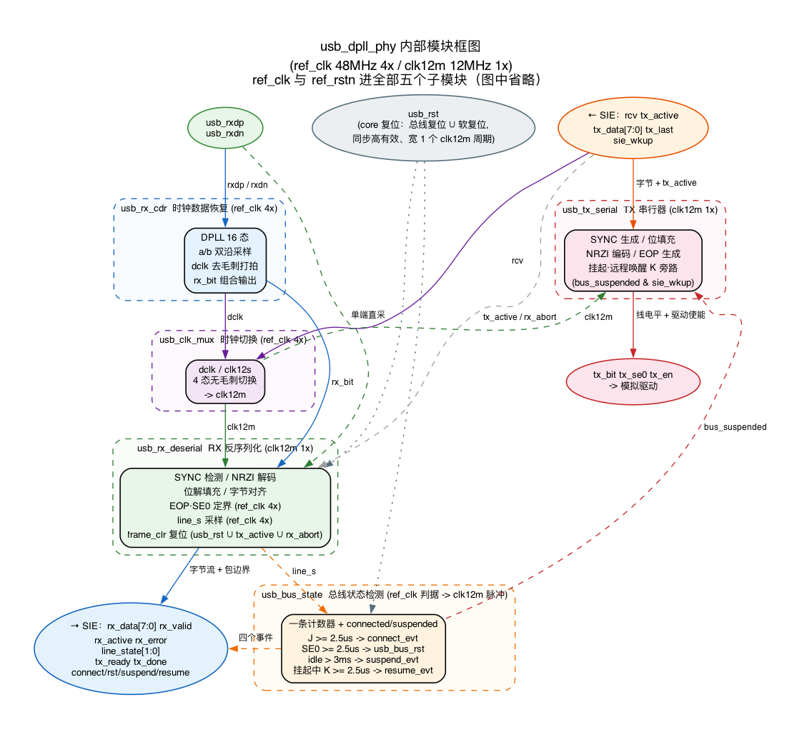

# PHY 设计报告（数字收发器 usb_dpll_phy）

> 本文是 **PHY（数字收发器 `usb_dpll_phy`）** 的汇总设计报告。
> 参考：`intel_sie_whitepaper_notes.md`（Intel SIE 白皮书精读笔记，`doc/` 下）。
> 设计范围：顶层 `usb_dpll_phy`（纯连线）**加**五个子模块，**全部在 `src/phy/` 下**——CDR `usb_rx_cdr` / 时钟切换 `usb_clk_mux` / RX 反序列化 `usb_rx_deserial` / TX 串行器 `usb_tx_serial` / 总线状态检测 `usb_bus_state`。
> PHY↔SIE 边界 = **字节级 + 线状态 + 四个总线事件**。
> 验证报告：`phy_verification.md`（顶层集成，18 用例）；五个子模块各有自己的验证报告。

---

## 0. 模块示意图（数据通路）

USB 设备控制器的数字部分自上而下三层：PHY → SIE → APB（接收），APB → SIE → PHY（发送）。本次设计的是 PHY 这一层。

```
数据通路：PHY → SIE → APB 三层

接收 RX（主机 → 设备）

  DP/DN 差分线
      │
      ▼
  PHY 数字收发器 ★本次设计★
  CDR → clk_mux → deserial
      │ 字节 + 侧带 + 四个事件
      ▼
  SIE 串行接口引擎
  包解析 + 事务逻辑
      │
      ▼
  APB 从接口 / 寄存器 / FIFO

发送 TX（设备 → 主机）

  APB 从接口 / 寄存器 / FIFO
      │
      ▼
  SIE 串行接口引擎
  事务逻辑
      │ tx_data / tx_last
      │ tx_ready / tx_done
      ▼
  PHY 的 tx_serial
  字节 → NRZI 位流 + SYNC/填充/EOP
      │ tx_bit / tx_se0 / tx_en
      ▼
  DP/DN 差分线（模拟收发器驱动）
```

PHY 做的是"差分线 ⇄ 字节流"。RX 链 `CDR → clk_mux → usb_rx_deserial` 把线电平恢复成对齐的字节流和包边界信号，字节级交给 SIE；TX 方向反过来，SIE 事务逻辑给出字节，PHY 的 `usb_tx_serial` 串行化成 NRZI 位流和线电平（`tx_bit` / `tx_se0` / `tx_en`），模拟收发器拿去驱动 DP/DN。发送路径跑 `clk12m` 1×，与 SIE 同域，见 `tx_serial_design.md`。

PHY 里另含总线状态检测：判据（J≥2.5µs = connect / SE0≥2.5µs = 总线复位 / idle>3ms = suspend / 挂起中 K≥2.5µs = resume）跑 `ref_clk`，线电平原样用 `usb_rx_deserial` 采好的 `line_s`，四个事件各出 1 个 `clk12m` 单拍脉冲交 SIE，见 `bus_state_design.md`。SIE 只做包解析、事务和端点管理，APB 负责寄存器与 FIFO 存取，都不在 PHY 的设计范围内。



图 0.1　PHY 内部模块框图：五个子模块、内部时钟与字节级边界。生成脚本 `tools/gen_fsm_diagrams.py block`。

---

## 1. 设计范围与定位

PHY = `usb_dpll_phy`，是 **USB 1.1 Full-Speed（12Mbps）设备** 中"最贴近物理线"的数字层，**不包含模拟收发器**（差分驱动/单端接收/1.5kΩ 上拉等由模拟 PHY 提供，本设计直接取用其 DP/DN 单端 `rxdp`/`rxdn`）。

五个子模块（全部在 `src/phy/`）：

| 子模块 | 时钟域 | 职责 | 用例 |
|--------|--------|------|------|
| `usb_rx_cdr` | ref_clk 4× | 从 DP/DN 恢复 `dclk` + `rx_bit` | 10 |
| `usb_clk_mux` | ref_clk 4× | `dclk` / `clk12s` 无毛刺切换出 `clk12m` | 7 |
| `usb_rx_deserial` | clk12m 1× + ref_clk 4× | 位→字节 + EOP/SE0 定界 | 11 ×2 模式 |
| `usb_tx_serial` | clk12m 1× | 字节→NRZI 位流 + SYNC/填充/EOP | 20 |
| `usb_bus_state` | ref_clk → clk12m | 连接/复位/挂起/唤醒计时 | 14 |

各子模块的职责细节见下文，权威用例数与判据在各自的验证报告里。

覆盖率数（DUT 口径，跨用例合并）：`usb_clk_mux` branch/expr/toggle 全 100%、line 7/8；`usb_rx_deserial` branch 60/60、expr 119/119、toggle 174/174、line 75/76；`usb_bus_state` 四项全 100%。

### 1.1 顶层 `usb_dpll_phy` 的端口与内部接线

顶层没有逻辑：没有参数、没有状态、没有表达式，`/*autodefine*/` 段只有四根内部线。它的全部内容是五个例化和一张接线表。

**端口**（26 根，按对端分三组）。「宽」写在端口名后面的方括号里，单比特省略；「内部接到」一列的含义是这根线在 PHY 内部接哪个子模块，输入行看去向、输出行看来源。

**一、时钟与复位**（3 根，全局）

| 端口 | 方向 | 内部接到 | 作用 |
|---|---|---|---|
| `ref_clk` | in | 五个子模块 | 4× 参考时钟（48MHz），全 PHY 的时基 |
| `ref_rstn` | in | 五个子模块 | 异步复位，低有效 |
| `usb_rst` | in | deserial + bus_state | core 复位脉冲，宽 1 个 `clk12m` 周期 |

**二、模拟收发器**（5 根，下行）

| 端口 | 方向 | 内部接到 | 作用 |
|---|---|---|---|
| `rxdp` / `rxdn` | in | CDR + deserial | DP / DN 单端电平，接收侧的入口 |
| `tx_bit` / `tx_se0` | out | tx_serial | 要驱动的线电平（J / K）/ EOP 的 SE0 标志 |
| `tx_en` | out | tx_serial + bus_state | 驱动器使能，也是 bus_state 的 `driving` 来源 |

**三、SIE**（18 根，上行）

| 端口 | 方向 | 内部接到 | 作用 |
|---|---|---|---|
| `rcv` | in | clk_mux | 方向选择：1 收（选 `dclk`），0 发（选 `clk12s`） |
| `tx_active` | in | deserial + tx_serial | 发送标志，门控 EOP 检测与 RX 解码 |
| `rx_abort` | in | deserial | 溢出中止，回 `USB_IDLE` 且不置 `rx_error` |
| `tx_data[7:0]` | in | tx_serial | 待发字节，LSb 先发 |
| `tx_last` | in | tx_serial | 与末字节同拍，标出包尾 |
| `sie_wkup` | in | tx_serial | 远程唤醒请求（电平） |
| `clk12m` | out | clk_mux | 恢复时钟，直接驱动 SIE 与 PHY 位流水线 |
| `rx_data[7:0]` | out | deserial | 恢复出的接收字节 |
| `rx_valid` | out | deserial | 每字节一拍脉冲，SIE 在脉冲拍锁存 |
| `rx_active` | out | deserial | 包接收中，下降沿 = 包结束 |
| `rx_error` | out | deserial | 接收错误（电平，回 idle 即清） |
| `line_state[1:0]` | out | deserial | `{rxdp, rxdn}` 透传 |
| `tx_ready` | out | tx_serial | 取走一个字节（1 拍） |
| `tx_done` | out | tx_serial | EOP 发完（1 拍） |
| `connect_evt` | out | bus_state | 连接事件脉冲 |
| `usb_bus_rst` | out | bus_state | 总线复位事件脉冲 |
| `suspend_evt` | out | bus_state | 挂起事件脉冲 |
| `resume_evt` | out | bus_state | 唤醒事件脉冲 |

三组的分界就是 PHY 的两个对外方向：往下接模拟收发器，往上接 SIE，另有全局的时钟与复位。端口含义见下文。

**内部线**（只有四根，位级信号到此为止，不再出顶层）：

| 线 | 从 | 到 |
|---|---|---|
| `dclk` | `usb_rx_cdr` | `usb_clk_mux` |
| `rx_bit` | `usb_rx_cdr` | `usb_rx_deserial` |
| `line_s[1:0]` | `usb_rx_deserial`（采样后） | `usb_bus_state` |
| `bus_suspended` | `usb_bus_state` | `usb_tx_serial`（唤醒旁路的挂起态） |

三处接线值得单记。一是 `line_s` **只由 deserial 采一次**，bus_state 不自己采 `rxdp`/`rxdn`，两个模块拿到的永远是同一对电平；`line_state` 是同一对电平的透传，给 SIE 用。二是 `tx_en` **组合直连**两处（模拟收发器与 bus_state 的 `driving`），本层不打拍也不跨域，理由见 `bus_state_design.md`。三是 `bus_suspended` **不出本层**：唤醒旁路的挂起条件是「总线已挂起（这里判的）+ SIE 请求唤醒」，读源比让 SIE 回送一份副本少一次往返，所以 SIE 只出 `sie_wkup`，PHY 的输入端口比原来少一根（见 `tx_serial_design.md`）。

---

## 2. 时钟方案与 CDC 边界（核心）

### 2.1 三个时钟域

| 时钟 | 频率 | 倍数 | 用途 |
|------|------|------|------|
| `ref_clk` | 48MHz | 4× | CDR / 时钟切换 / EOP·SE0 定界 / 总线状态计时 |
| `clk12m` | 12MHz | 1× | 位→字节流水线 + SIE（接收 = `dclk`，发送 = `clk12s`） |
| `pclk` | 24MHz | — | APB / 端点 FIFO / 寄存器 |

### 2.2 恢复时钟作为真实时钟（Intel 方案）

白皮书（笔记 `intel_sie_whitepaper_notes.md`）确立的架构：**恢复时钟 `dclk` 当作真实时钟用**，经 `usb_clk_mux` 与发送时钟 `clk12s` 无毛刺切换，产生 `clk12m` **直接驱动 SIE**（不是当作使能 `bit_ce`）。

- 接收时 `clk12m = dclk`（跟主机晶振，1× 域逐字节消费接收数据）；
- 发送时 `clk12m = clk12s`（本地 ref_clk ÷ 4，1× 域逐字节供发送数据）；
- 切换由方向信号 `rcv` 控制，`usb_clk_mux` 保证无毛刺。

### 2.3 CDC 边界：PHY↔SIE 无异步 CDC，唯一异步 CDC 在 SIE↔FIFO

- **PHY ↔ SIE**：PHY 把**字节级信号 + 线状态 + 四个事件**（`rx_data` / `rx_valid` / `rx_active` / `rx_error` / `line_state` / `tx_ready` / `tx_done` / `connect_evt` / `usb_bus_rst` / `suspend_evt` / `resume_evt`，均随 `clk12m`）交给 SIE，边沿都对齐 `ref_clk`，是**同步派生时钟交接**，**没有异步 CDC、与 pclk 无关**。位→字节恢复在 PHY 内部（`usb_rx_deserial`）完成，SIE 事务逻辑在 `clk12m` 域直接采样（包结束 = `rx_active`↓，UTMI `RXActive` 模型，**无 `rx_last`**）。PHY 内部位级信号 `clk12m` / `rx_bit` / `rxdp` / `rxdn` / `ref_clk` **不再跨出 PHY**。
- **SIE ↔ FIFO**：`usb_sie_cdc`，全设计**唯一异步 CDC**（`clk12m` 主机晶振 vs `pclk` 本地晶振），四相闭环握手（无 FIFO），见 `03_usb_sie_cdc_design.md`。

---

## 3. 统一信号命名（跨模块一致）

为避免各子模块连接信号名不统一，PHY 内部及其与 SIE 的边界统一使用下表命名。

**PHY 内部信号与顶层输入**（位级信号**不跨出 PHY**）：

| 信号 | 方向 | 含义 |
|------|------|------|
| `dclk` | CDR → clk_mux | 恢复的 12MHz 位时钟（`state[1]` 打一拍） |
| `rx_bit` | CDR → deserial | NRZI 电平（`state[2]`，0=K / 1=J） |
| `rxdp` / `rxdn` | 模拟 PHY → deserial | D+/D- 单端 |
| `line_s[1:0]` | deserial → bus_state | `ref_clk` 域采样的 `{rxdp, rxdn}` |
| `tx_en` | tx_serial → 模拟 PHY + bus_state | 驱动器使能，`driving` 的来源（组合直连） |
| `usb_rst` | 顶层 → deserial + bus_state | core 复位，宽 1 个 `clk12m` 周期 |
| `ref_rstn` | 全局 → 全 PHY | 异步复位，低有效 |
| `clk12s` | clk_mux 内部 | 发送 1× 时钟 = ref_clk ÷ 4 |
| `clk12m` | clk_mux → deserial + tx_serial | 位流水线主时钟 |
| `ref_clk` | 全局 → 全 PHY | 4× 参考时钟 |

**PHY↔SIE 边界信号（字节级 + 线状态 + 四个事件，均随 `clk12m`）**：

| 信号 | 方向 | 含义 |
|------|------|------|
| `rcv` | SIE → clk_mux | 方向信号（1=接收选 `dclk`，0=发送选 `clk12s`） |
| `tx_active` | SIE → deserial + tx_serial | TX 发送标志（门控 EOP 检测与 RX 解码） |
| `rx_abort` | SIE → deserial | 溢出中止：回 `USB_IDLE`，不置 `rx_error` |
| `tx_data[7:0]` | SIE → tx_serial | 待发送字节（LSb 先发） |
| `tx_last` | SIE → tx_serial | 与末字节同拍，保持到该字节的 `tx_ready` |
| `sie_wkup` | SIE → tx_serial | 远程唤醒请求（电平，`clk12m` 域） |
| `bus_suspended` | bus_state → tx_serial | 挂起态，内层一根线，不出本层 |
| `tx_ready` / `tx_done` | tx_serial → SIE | 取走一个字节 / EOP 发完（各 1 拍） |
| `tx_bit` / `tx_se0` / `tx_en` | tx_serial → 模拟 PHY | 线电平 / SE0 标志 / 驱动使能 |
| `rx_data[7:0]` | deserial → SIE | 恢复的接收字节（LSb 对齐，维持满字节周期） |
| `rx_valid` | deserial → SIE | 每字节一拍脉冲（SIE 同域在脉冲拍锁存） |
| `rx_active` | deserial → SIE | 包接收中，下降沿 = 包结束 |
| `rx_error` | deserial → SIE | 接收错误（电平，帧机回 idle 即清） |
| `line_state[1:0]` | deserial → SIE | `{rxdp, rxdn}` 透传（复位/挂起/SE0 检测） |
| `connect_evt` / `usb_bus_rst` | bus_state → SIE | 连接 / 总线复位，各 1 拍脉冲 |
| `suspend_evt` / `resume_evt` | bus_state → SIE | 挂起 / 唤醒，各 1 拍脉冲 |

> `rcv` 由 SIE 产生，策略 `rcv = connected & ~tx_active & ~(sie_susp & sie_wkup)`，判据是"设备有没有在驱总线"。
> 其中的 `sie_susp` 是 SIE 自己那份挂起标志（SIE 内部由 `suspend_evt`/`resume_evt` 维护），只用来算 `rcv`，不外送。
> `tx_active` 是独立的发送标志，**不与 `rcv` 合并**。
> `tx_data` 里的 CRC 字节由 SIE 摆好位序当普通数据送来，契约见 `tx_serial_design.md`。

> `tx_bit`/`tx_se0`/`tx_en` 三个直连模拟 PHY 的信号**全部寄存器直出**（`code_rtl.md` 规则 6）：`tx_bit`/`tx_se0` 走"现态译码 `D = f(现态)`"，`tx_en` 走兜底条款（D 要跟随 `tx_active`）——代价与记账见 `tx_serial_design.md`。
> `usb_rst` 是唯一一个"由顶层并好再送进来"的复位：总线复位（`usb_bus_state` 的 `usb_bus_rst`）与软件复位（APB `SWRST`）在模块外并成它，进 `usb_rx_deserial` 与 `usb_bus_state` 时已是同步高有效的 1 个 `clk12m` 周期脉冲。

---

## 4. PHY 内部子模块要点

### 4.1 `usb_rx_cdr` — 时钟数据恢复（Intel 16 态 DPLL）

- **4× 过采样 + a/b 双沿采样**（等效 8×），16 态状态机 `state[1]=恢复时钟`、`state[2]=NRZI 电平`；
- 频率自适应：短 bit 从 2/6 直接切环、长 bit 经 F/B 绕行，恢复时钟双向跟随主机位率（±0.25%）；
- `state[1]` 打一拍去毛刺 → `dclk`；`state[2]` 组合输出 `rx_bit`；
- 详见 `02_cdr_design.md`。

### 4.2 `usb_rx_deserial` — RX 反序列化 / 字节恢复

处理链：NRZI 解码 → SYNC 检测（容忍 CDR 吃 1~2 位，找 `≥4 个 0 + 1` 尾巴）→ 位解填充（SYNC 尾 1 计入）→ 字节对齐（LSb first）→ EOP/SE0 定界（独立 ref_clk 域，SE0→J 锚定包尾）。

- 它吃的是 PHY 内部位级信号（`clk12m`/`rx_bit`/`rxdp`/`rxdn`/`ref_clk`），吐的是 PHY↔SIE 的字节级边界；
- 位→字节处理（NRZI/SYNC/解填充/字节对齐）跑在 **clk12m**（= clk_mux 之后的 dclk）1× 域；SE0/EOP 定界留在 ref_clk 4× 域（看单端沿）；
- `rx_data` 维持满 667ns + `rx_valid` 每字节一拍脉冲，供 SIE 事务逻辑在 clk12m 域同域锁存；PID 靠 SIE 数脉冲（`rx_active`↑ 后第 1 个 `rx_valid` 脉冲的字节）；包结束靠 `rx_active`↓（UTMI `RXValid`/`RXActive`，**无 `rx_start`/`rx_last`**）；
- 帧机回 `USB_IDLE` 的三个触发并成一根 `frame_clr = tx_active | rx_abort | usb_rst`，三者都是"本拍就回 IDLE、冻结位流水、不置 `rx_error`"；`rx_d1`/`rx_d2` 与 `line_s` 采样器不跟着复位（它们是总线的影子，强行复位会伪造一次跳变）；
- 详见 `rx_deserial_design.md`。

### 4.3 `usb_clk_mux` — 时钟切换（无毛刺）

- 接收/发送方向由 `rcv` 选通：`rcv=1` 选 `dclk`、`rcv=0` 选 `clk12s`（ref_clk÷4），输出 `clk12m` 驱动 PHY 后级 + SIE；
- 无毛刺切换（Intel 白皮书原话"照搬"，见笔记 `intel_sie_whitepaper_notes.md`），详见 `02_clk_mux_design.md`。

### 4.4 `usb_tx_serial` — TX 串行器

- **位级执行器**：SIE 给字节（`tx_data`/`tx_last`），本模块自产 SYNC + 位填充 + NRZI + EOP，输出 `tx_bit`(J/K) / `tx_se0`(EOP) / `tx_en`(驱动使能) 给模拟驱动；三者直连模拟 PHY，按 `code_rtl.md` 规则 6 做**寄存器直出**（`tx_bit`/`tx_se0` 现态译码，`tx_en` 走兜底条款，见 `tx_serial_design.md`）；
- 跑 **`clk12m` 1×**（发送期 = `clk12s`），与 SIE 同域，字节握手不需跨域；填充用"插 0 + hold 一拍"（内部无 FIFO，包尾严丝合缝接 EOP），不用 `usb_bit_stuff.v`；
- **不碰 CRC/PID**：CRC 字节由 SIE 算好并摆好位序当普通数据字节送来（契约见 `tx_serial_design.md`）；
- 详见 `tx_serial_design.md`。

### 4.5 `usb_bus_state` — 线状态计时

- 判据全部跑 `ref_clk` 4×，与位流水线并行；线电平用 `usb_rx_deserial` 采好的 `line_s`（本模块不自己采），只用它出一拍延迟的 `line_s_dly` 判线变化；
- **判据**：J 态 ≥2.5µs = connect；SE0 ≥2.5µs = 总线复位；idle >3ms = suspend；挂起中主机驱 K ≥2.5µs = resume。四个事件各出 1 个 `clk12m` 单拍脉冲；
- **结构与契约**：一条计数器 + 两个标志位 + 两个翻转位、无状态机；计数上界 = 门限 + 1；`connected` 清于 `usb_rst`（core 复位），`driving`（= `tx_en`）与线变化都清零计数器；跨域延迟 1..4 个 `ref` 拍（上界一个 `clk12m` 周期）。详见 `bus_state_design.md`、`bus_state_verification.md`；
- 与 `usb_rx_deserial` 的分工：deserial 的 SE0 计数只服务 EOP 定界（~160ns 量级），**从不判复位**；本模块判复位、连接、挂起、唤醒四个宏观事件。

---

## 5. 关键设计点小结

1. **恢复时钟当真实时钟**：`dclk` → clk_mux → `clk12m` 直接驱动 PHY 位流水线 + SIE，PHY↔SIE 同步交接、无异步 CDC；
2. **唯一异步 CDC 在 SIE↔FIFO**：`usb_sie_cdc` 四相闭环握手，与 pclk 无关（PHY 侧不碰 pclk）；
3. **统一信号命名**：`dclk`/`rx_bit`/`clk12m`/`rcv`/`rx_*`/`tx_*`，跨模块一致；
4. **子模块拆解**：CDR / 时钟切换 / 反序列化 / 发送串行 / 总线状态检测各自独立，便于单独验证与复用；
5. **PHY↔SIE 边界 = 字节级 + 线状态 + 四个总线事件**：出 `rx_data`/`rx_valid`/`rx_active`/`rx_error`/`line_state`/`tx_ready`/`tx_done`/四个事件脉冲，进 `rcv`/`tx_active`/`rx_abort`/`tx_data`/`tx_last`/`sie_wkup`；
6. **复位分两条**：`ref_rstn` 异步打底，`usb_rst`（core 复位，宽 1 个 `clk12m` 周期）清协议状态；`usb_bus_state` 的翻转位只吃 `ref_rstn`；
7. **可综合**：无 `#`/`initial`/`$display`，复位回 idle J。

---

*参考：`doc/intel_sie_whitepaper_notes.md`；各子模块的设计报告与验证报告见 `doc/design_rpt/`（`02_cdr_*` / `02_clk_mux_*` / `clk_mux_verification.md` / `rx_deserial_*` / `tx_serial_*` / `bus_state_*`）。*
